# ChargeGrid Intelligence — Sprint 4: Solução Final Integrada

[](https://github.com/thorflk/SPRINT04-PYTHON-GTLF/actions/workflows/ci.yml)

### Pensamento Computacional e Automação com Python · FIAP x GoodWe · EV Challenge 2026 · Grupo GTLF

> **Aviso:** todos os dados deste repositório são **simulados**. Não há hardware, rede OCPP/MODBUS nem medição real.
> A simulação segue premissas técnicas documentadas e rastreáveis (seção 12). Tarifas e fator de emissão vêm de
> fontes oficiais (seção 10).

**Em uma frase:** um eletroposto de shopping com usina solar, **bateria** e quatro carregadores GoodWe HCA G2, gerido
por um controlador em Python que **prevê** a demanda e o sol, **guarda energia solar para o horário em que a rede é
mais cara**, **agenda** cada recarga pelo horário de saída do motorista e prova o ganho comparando o mesmo dia em quatro
estratégias de operação.

| No dia de demonstração, a solução final (D) comparada ao eletroposto sem gestão (A) | |
|---|---|
| Custo da energia comprada da rede | **−33,6%** (R$ 173,97 → R$ 115,51) |
| Energia comprada da rede na ponta (17h30–20h30) | **−46,5%** (47,1 → 25,2 kWh) |
| Energia renovável nas recargas | **0% → 32,5%** |
| Tempo acima do limite seguro da rede | **65 min → 0** (A chega a 31,2 kW, acima até dos 30 kW disponíveis) |
| Margem do operador (receita − custo da rede) | **R$ 6,29 → R$ 62,44** |
| Carga prometida aos motoristas | **9 de 9** entregues |

E não é sorte de um dia: em **30 dias simulados**, D teve custo de rede menor que o eletroposto sem gestão e que a
Sprint 3 em **30 de 30**, e **0 minuto** acima do limite da rede (seção 8.3).

---

## Sumário

1. [Equipe](#1-equipe)
2. [Vídeo técnico](#2-vídeo-técnico)
3. [Evolução: Sprint 1 → Sprint 4](#3-evolução-sprint-1--sprint-4)
4. [Arquitetura final e integração dos sistemas](#4-arquitetura-final-e-integração-dos-sistemas)
5. [Como cada item resolve um ponto-chave do desafio](#5-como-cada-item-resolve-um-ponto-chave-do-desafio)
6. [Alinhamento ao desafio GoodWe](#6-alinhamento-ao-desafio-goodwe)
7. [Alinhamento à disciplina](#7-alinhamento-à-disciplina)
8. [Resultados quantitativos e qualitativos](#8-resultados-quantitativos-e-qualitativos)
9. [Avaliação crítica: sustentabilidade, inovação e limites](#9-avaliação-crítica-sustentabilidade-inovação-e-limites)
10. [Referências: frameworks, ferramentas, linguagens e sensores](#10-referências-e-conexões-com-frameworks-ferramentas-linguagens-e-sensores)
11. [Como executar](#11-como-executar)
12. [Premissas](#12-premissas)
13. [Estrutura do repositório](#13-estrutura-do-repositório)

---

## 1. Equipe

| Nome | RM |
|---|---|
| Fernando Hideki Rosa Oda | 571408 |
| Léo Moreno Sambo | 569556 |
| Thor Ferreira Camargo | 569543 |
| Gabriel Botelho Romão | 570589 |
| Rafael Marinucci Peres | 569729 |
| David dos Reis Cardoso | 568938 |

## 2. Vídeo técnico

Vídeo (YouTube, não listado, até 5 minutos): **[link a inserir]**

---

## 3. Evolução: Sprint 1 → Sprint 4

| | Sprint 1 | Sprint 2 | Sprint 3 | **Sprint 4 (este repositório)** |
|---|---|---|---|---|
| Entrega | Pesquisa e arquitetura em 3 camadas | Script com 4 módulos em sequência | Protótipo integrado: laço de 5 em 5 min | **Solução final: geração + armazenamento + uso, otimizados** |
| Energia renovável | Não abordada | Citada | Solar consumida primeiro | Solar **+ bateria**, com despacho **preditivo** |
| Controle | Descrito | Fator proporcional | Proporcional com teto `limite + solar` | **Agendamento por folga**: garante a carga prometida e adia quem pode esperar |
| Custo de energia | — | — | Custo fixo (premissa) | **Tarifa Branca oficial** (ANEEL), por posto horário |
| IA | Conceito | Texto fixo | Previsão por hora, só informativa | Previsão **comanda** a bateria |
| Interface | Slides | Terminal | Terminal + PNG | Terminal + PNG + **painel web interativo** + **assistente virtual** |
| Prova de ganho | — | — | Um cenário | **4 estratégias no mesmo dia** + varredura de 30 dias |
| Integração com o Challenge | — | — | Regras adaptadas | Regras adaptadas + **exportação no contrato de dados da API do Challenge** |

**O que mudou no modelo, e por quê.** Na Sprint 3 o carro ia embora assim que terminava de carregar, então não havia
como "agendar" nada. Na Sprint 4 cada motorista informa **quanto tempo fica no shopping** (1h30 a 4h30), o carro ocupa
o ponto até sair e recebe na chegada uma **promessa de carga**: o SoC que alcançaria nesse tempo com 85% da potência
máxima. Como chegadas, pontos e saídas não dependem da estratégia, **o mesmo dia de demanda roda nas quatro estratégias**
e a comparação é justa. Por isso os números do dia de demonstração não são os mesmos da Sprint 3 (e a seed de
demonstração foi reescolhida por uma regra explícita, seção 12).

---

## 4. Arquitetura final e integração dos sistemas

Os seis diagramas (posicionamento, camadas, unifilar, laço, decisão da bateria e sequência) estão em
[`docs/diagramas.md`](docs/diagramas.md). Os três principais estão abaixo.

### 4.1 Onde este repositório se encaixa no ChargeGrid

O grupo tem duas entregas que se complementam:

- **[ChargeGrid-Manager](https://github.com/rafaperes21/ChargeGrid-Manager)** (Challenge) é a **plataforma**: API
  FastAPI, banco PostgreSQL, portal do proprietário (dashboard, fluxo de energia, tarifas, relatórios), portal do
  cliente (sessão, mapa, fila, assistente) e microsserviço de IA com Prophet.
- **Este repositório** é o **motor de otimização e análise em Python**: simula o eletroposto intervalo a intervalo,
  decide o despacho da bateria e a potência de cada carro, e **mede** o ganho de cada decisão. Roda com `pip install`,
  sem banco nem servidor, o que permite testar algoritmos e comparar estratégias em segundos.

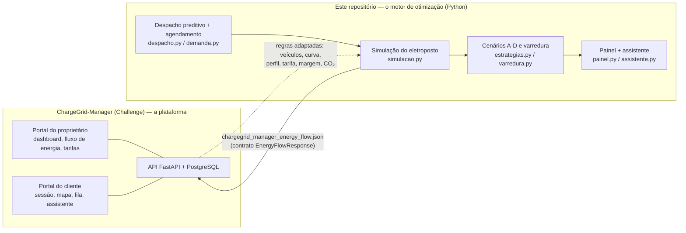

**A integração é concreta, não só conceitual:**

1. **Mesmo contrato de dados.** `chargegrid/exportar.py` grava o dia simulado em
   `saida/chargegrid_manager_energy_flow.json` com a estrutura exata de `EnergyFlowResponse`
   (`backend/app/schemas/energy.py` do Challenge): a mesma resposta que a API entrega à tela "Fluxo de energia" do
   portal do proprietário. Os nomes dos campos são verificados em `tests/test_exportar.py`, e a convenção de sinal da
   bateria (positivo = descarregando) é a do SEMS+.
2. **Mesmas regras.** Catálogo de veículos, curva de carga, perfil de chegadas, dinheiro em `Decimal`, margem de
   segurança de 0,80, convenção de perdas da bateria, Tarifa Branca e fator de emissão vêm do Challenge (tabela 6.3).
3. **Mesmo vocabulário de operação.** O despacho preditivo corresponde ao modo `peak_reserve` do Challenge, e o
   exportador grava esse valor em `dispatch_mode`. A diferença é que aqui a decisão usa a previsão de demanda e de
   sol, em vez de uma regra fixa por horário (seção 9.2).

### 4.2 Esquema elétrico

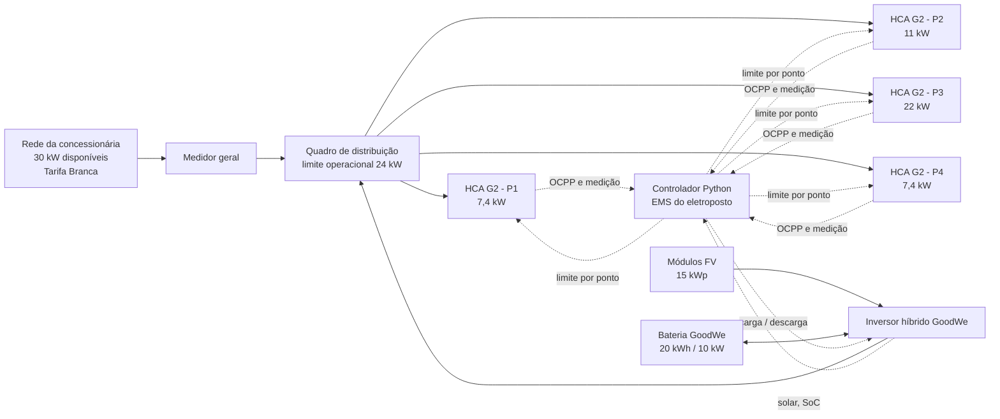

A rede entrega no máximo **24 kW** (30 kW × 0,80 de margem). Solar e bateria entram pelo inversor híbrido no mesmo
barramento, então o teto para os carros é `limite + solar + descarga possível da bateria`.

### 4.3 O laço de controle: o que acontece a cada 5 minutos

Cada intervalo (`chargegrid/simulacao.py`) executa, em ordem:

1. **Sessões.** Carros que chegaram à hora de saída geram `StopTransaction`. Novas chegadas geram `StartTransaction`
   e recebem a promessa de carga.
2. **Demanda.** A potência desejada de cada carro é `min(nominal do ponto, carregador de bordo, curva por SoC)`.
3. **Plano da bateria** (`despacho.plano_da_bateria`), descrito em 4.4.
4. **Agendamento** (`demanda.alocar_por_folga`):
   - primeiro, cada carro recebe seu **piso**, a menor potência que ainda cumpre a promessa até a saída;
   - a sobra vai para quem tem **menor folga** (quem sai mais cedo ou ainda precisa de mais carga);
   - na ponta da distribuidora, a sobra é limitada à energia renovável disponível, e quem pode esperar é **adiado**
     para depois da ponta.
5. **Comandos.** Um `SetChargingProfile` é enviado só para os pontos cujo limite mudou.
6. **Despacho** (`despacho.despachar`): a energia vem de **solar → bateria → rede**, com a rede sempre ≤ 24 kW e a
   bateria nunca carregando pela rede.
7. **Medição e tarifação.** `MeterValues` com os registradores no estilo MODBUS; preço ao motorista por faixa horária
   e custo da rede pela Tarifa Branca, ambos em `Decimal`.

### 4.4 O despacho preditivo da bateria (a peça central)

O raciocínio econômico é simples:

- um kWh solar usado direto no carro antes da ponta evita **R$ 0,69** de rede;
- o mesmo kWh guardado e entregue na ponta evita **R$ 1,56 × 0,90 de eficiência = R$ 1,40**.

Por isso a bateria deve **chegar cheia à ponta**, mas sem desperdiçar sol. Em cada intervalo, a previsão decide:

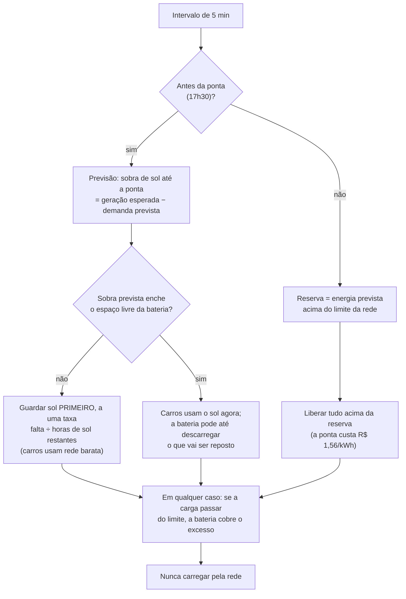

**Como chegamos a essa regra (e o que não funcionou).** A primeira versão mandava todo o sol para a bateria antes da
ponta. Ela enchia às 11h e desperdiçava o sol da tarde, e ficou **mais cara que o autoconsumo simples** em 3 de 4 dias
testados. A segunda versão decidia "guardar ou não" com um liga-desliga, e a bateria oscilava a cada 5 minutos. A
versão final usa a **previsão** para guardar só o que a sobra de sol não vai repor, a uma **taxa proporcional**. Essa
iteração, medida com a varredura de seeds, é o pensamento computacional aplicado: hipótese, teste, medição e correção.

---

## 5. Como cada item resolve um ponto-chave do desafio

| Ponto-chave do desafio | Item da solução | Como resolve | Evidência |
|---|---|---|---|
| Usar energia renovável **gerada no local** | Usina solar + despacho solar primeiro (`solar.py`, `despacho.py`) | Toda geração vai antes para os carros ou para a bateria; a rede só cobre o resto | 38,1 kWh de sol direto nos carros no dia de demonstração (seção 8.1) |
| **Armazenar** energia renovável | Inversor híbrido + bateria (`bateria.py`) | Guarda a sobra de sol, com SoC mínimo de 10% e perdas de 10% modeladas; nunca carrega pela rede | 21,2 kWh de sol guardados, 19,1 kWh entregues; balanço de energia testado em `test_simulacao.py` |
| **Usar** a renovável quando ela vale mais | Despacho preditivo (`despacho.plano_da_bateria`) | Chega à ponta com a bateria cheia e descarrega quando o kWh da rede custa R$ 1,56 | D: 18,0 kWh entregues na ponta; C (sem previsão): 0 kWh (gráfico 05) |
| Não sobrecarregar a rede | Controle de demanda + bateria cortando pico | O teto dos carros respeita 24 kW; acima disso, a bateria cobre | 0 min acima do limite em 30 dias; sem gestão: 2.215 min (seção 8.3) |
| Atender bem o motorista | Agendamento por folga (`demanda.alocar_por_folga`, `Sessao.piso_kw`) | Garante a carga prometida até a hora de saída; adia só quem tem folga | 9/9 promessas cumpridas no dia; em 30 dias, 89,7% contra 85,3% da Sprint 3 |
| **Monitoramento inteligente** | Telemetria a cada 5 min, OCPP, medidor, painel | Cada kW tem origem registrada (solar, bateria, rede) e aparece no painel | `telemetria.csv`, `ocpp_log.jsonl` (433 mensagens), painel (seção 8.4) |
| Operar com hardware GoodWe real | Contratos OCPP e SEMS+ (`ocpp.py`, `exportar.py`) | Comandos e leituras no formato dos protocolos; dados no formato da API do Challenge | `ocpp_exemplo.jsonl`, `chargegrid_manager_energy_flow.json` |
| Viabilidade econômica | Tarifa Branca + métricas de custo e margem | Mostra onde a operação perde dinheiro (ponta) e quanto a solução recupera | Margem de R$ 6,29 → R$ 62,44 por dia (seção 8.1) |
| Decisão do operador | Assistente virtual + painel interativo | Perguntas em português respondidas com os números do dia; simulação de outros tamanhos de usina e bateria | Seção 8.4 |

---

## 6. Alinhamento ao desafio GoodWe

### 6.1 Por que cada tecnologia GoodWe

| Tecnologia | Papel na solução | Por que ela, e não outra coisa |
|---|---|---|
| **Carregador GoodWe HCA G2** (7,4 / 11 / 22 kW) | Os quatro pontos de recarga | É o equipamento do desafio. As três potências mostram o gargalo real: o carregador de bordo do carro limita a potência (um carro de 7,4 kW num ponto de 22 kW carrega a 7,4 kW). A GoodWe posiciona o HCA G2 como integrado a inversor e bateria para recarga com energia solar ([página oficial](https://en.goodwe.com/hca-g2)) |
| **Inversor híbrido GoodWe** (linha de inversores híbridos trifásicos, como a série ET) | Converte a geração FV e faz a interface da bateria | Um único equipamento para solar e bateria. É o que torna possível "guardar sol para a ponta" e comandar carga/descarga por setpoint |
| **Bateria GoodWe** (linha Lynx; premissa de 20 kWh / 10 kW) | Armazena a sobra solar | Leva a energia do meio-dia para a ponta da noite, que a Sprint 3 mostrou ser o horário de maior demanda. A capacidade e a potência são premissa de simulação, iguais às do estabelecimento de demonstração do Challenge, e não a ficha técnica de um modelo |
| **SEMS+** (monitoramento GoodWe) | Fonte de leitura de solar, SoC e carregadores | O SEMS+ é *pull-only*, então o controle é feito no software e as leituras seguem o contrato do Challenge (seção 4.1) |

### 6.2 Por que cada conceito sustentável

| Conceito | Onde está | Por quê |
|---|---|---|
| Autoconsumo de geração distribuída | `despacho.despachar` | Energia gerada e consumida no local não passa pela rede: sem perdas de transmissão e sem custo de compra |
| Armazenamento para deslocar energia no tempo | `bateria.py`, `despacho.plano_da_bateria` | O sol é máximo ao meio-dia e a demanda, à noite. Sem armazenamento, a renovável não chega a quem precisa |
| Resposta da demanda e corte de pico | `demanda.alocar_por_folga` | Tirar consumo da ponta alivia a rede justamente quando ela está mais carregada e é mais cara |
| Sinal de preço (tarifa horária) | `tarifacao.py` | A Tarifa Branca dá o incentivo econômico que o algoritmo segue; é a ponte entre sustentabilidade e viabilidade |
| Emissões | `relatorio.metricas` | CO₂ calculado com o fator oficial do SIN, sem exagerar o ganho (seção 9.1) |

### 6.3 Regras e dados trazidos do Challenge (ChargeGrid-Manager)

| Regra | Origem no Challenge | Onde está aqui |
|---|---|---|
| Catálogo de veículos e gargalo do carregador de bordo | `backend/simulador/vehicles.py` | `chargegrid/veiculos.py` |
| Curva de carga: platô e queda a partir de 80% de SoC | `backend/simulador/curve_engine.py` | `chargegrid/sessoes.py` |
| Perfil de chegadas de um shopping | `backend/simulador/profiles.py` | `chargegrid/config.py` |
| Dinheiro em `Decimal`, `ROUND_HALF_UP` | `backend/app/services/pricing.py` | `chargegrid/tarifacao.py` |
| Margem de segurança de 0,80 | `backend/app/services/dimensionamento.py` | `chargegrid/config.py` |
| Bateria 20 kWh / 10 kW; perdas aplicadas na carga; nunca carrega pela rede | `backend/app/services/energy_dispatch.py` | `chargegrid/bateria.py`, `chargegrid/despacho.py` |
| Tarifa Branca B3 (Enel SP) e fator de emissão do SIN | `docs/sers-sprint4.md`, seção 6.5 | `chargegrid/config.py` |
| Contrato `EnergyFlowResponse` | `backend/app/schemas/energy.py` | `chargegrid/exportar.py` |

---

## 7. Alinhamento à disciplina

### 7.1 Os quatro pilares do pensamento computacional

| Pilar | Onde aparece |
|---|---|
| **Decomposição** | O problema "operar um eletroposto" foi dividido em módulos com uma responsabilidade cada: física (`solar`, `bateria`, `sessoes`), decisão (`despacho`, `demanda`, `previsao`), protocolos (`ocpp`, `medidor`, `exportar`), análise (`relatorio`, `graficos`, `varredura`) e interface (`painel`, `assistente`) |
| **Reconhecimento de padrões** | Sazonalidade horária da demanda (pico à noite) e da geração (pico ao meio-dia), cuja defasagem é o motivo da bateria; padrão de preço da Tarifa Branca |
| **Abstração** | Um intervalo de 5 min como unidade de tempo; `Estrategia` reduz uma forma de operar a 4 atributos; `Instalacao` agrupa o que o painel deixa variar; `Despacho` representa o fluxo de energia de um instante |
| **Algoritmos** | Agendamento por menor folga com pisos (variação de *least laxity first*), despacho guloso com previsão, janela deslizante do pico, erro médio absoluto no backtest e escolha da seed por regra explícita |

### 7.2 Conceitos de Python aplicados

| Conceito | Exemplo no código |
|---|---|
| Funções puras e parâmetros com valor padrão | `despacho.despachar`, `demanda.alocar_por_folga`, `tarifacao.custo_rede_do_intervalo` |
| Classes, `dataclass` (inclusive `frozen`) e propriedades | `Bateria`, `Sessao`, `Despacho`, `Estrategia`, `Instalacao`, `Pedido` |
| Listas, dicionários, tuplas e compreensões | `ESTRATEGIAS`, `pedidos`, `CAMPOS_PONTO` |
| Laços e condicionais | laço de ticks em `simulacao.simular_dia` |
| Módulos e pacotes; importação tardia para evitar ciclo | pacote `chargegrid/`; `previsao.demanda_prevista_padrao` |
| Memorização (`functools.lru_cache`) | previsão calculada uma vez em `previsao._demanda_prevista` |
| Arquivos CSV, JSON e JSON Lines | `relatorio.salvar_saidas`, `exportar.salvar_energy_flow`, `ocpp.salvar_jsonl` |
| pandas (`groupby`, `pivot`, `concat`) | `previsao.ajustar`, `varredura.tabela_resumo` |
| Visualização: matplotlib e Altair | `graficos.py` (7 PNG), `painel.py` |
| Interface web com Streamlit e estado de sessão | `painel.py` (`st.cache_resource`, `st.session_state`, `st.chat_input`) |
| Processamento de texto: normalização Unicode e expressões regulares | `assistente._normalizar`, `re.search` para "sessão 3" |
| Tratamento de exceções | `ValueError` em `bateria.aplicar`, `tarifacao`, `sessoes`; validação da linha de comando em `main.py` |
| `decimal.Decimal` para dinheiro | `tarifacao.py`, `relatorio.metricas` |
| Pseudoaleatoriedade reprodutível | `random.Random(seed)`: mesma seed, mesmo dia |
| Linha de comando (`argparse`) | `main.py`, `varredura.py` |
| Testes automatizados (`pytest`), inclusive testes de propriedade e da interface | 230 testes em `tests/`, incluindo `test_painel.py` com `streamlit.testing` |
| Integração contínua | `.github/workflows/ci.yml`: lint, testes e execução em Python 3.10, 3.12 e 3.14 |

---

## 8. Resultados quantitativos e qualitativos

> Todos os números são de **simulação**. Rodar `python main.py` reproduz exatamente esta seção, e
> `python -m chargegrid.varredura --n 30` reproduz a 8.3. Arquivos brutos em [`docs/resultados/`](docs/resultados/).

### 8.1 O mesmo dia em quatro estratégias (seed 15)

**A** = sem gestão (rede pura, sem limite) · **B** = solar + controle de demanda (Sprint 3) · **C** = B + bateria em
autoconsumo (descarrega sempre que falta sol) · **D** = solução final (despacho preditivo + agendamento por folga).

| Indicador | A — Sem gestão | B — Solar + controle (Sprint 3) | C — + Bateria (autoconsumo) | D — Solução final (preditiva) |
|---|---:|---:|---:|---:|
| Energia entregue aos veículos (kWh) | 175,9 | 175,9 | 175,9 | 175,9 |
| Promessas de carga cumpridas (%) | 100,0 | 100,0 | 100,0 | 100,0 |
| Energia solar direto nos carros (kWh) | 0,0 | 38,1 | 38,1 | 38,1 |
| Energia entregue pela bateria (kWh) | 0,0 | 0,0 | 19,0 | 19,1 |
| Energia comprada da rede (kWh) | 175,9 | 137,7 | 118,7 | 118,7 |
| … na ponta, 17h30–20h30 (kWh) | 47,1 | 43,6 | 43,6 | **25,2** |
| Energia renovável nas recargas (%) | 0,0 | 21,7 | 32,5 | 32,5 |
| Pico de potência na rede (kW) | 31,2 | 24,0 | 24,0 | 24,0 |
| Minutos acima do limite de 24 kW | 65 | 0 | 0 | 0 |
| Minutos acima dos 30 kW disponíveis | 15 | 0 | 0 | 0 |
| Custo da energia da rede (R$) | 173,97 | 144,34 | 130,64 | **115,51** |
| Receita das recargas (R$) | 180,26 | 178,05 | 178,05 | 177,94 |
| Margem do operador (R$) | 6,29 | 33,72 | 47,42 | **62,44** |
| CO₂ da energia da rede (kg) | 8,11 | 6,35 | 5,47 | 5,47 |

**Leitura (cada linha é uma peça da solução):**

- **A → B (solar + controle):** −R$ 29,63. A solar cobre 21,7% da energia e o controle elimina os 65 minutos acima
  do limite. Sem gestão, a rede chega a **31,2 kW, acima dos 30 kW disponíveis**: na prática, risco de desarme.
- **B → C (bateria simples):** −R$ 13,70. A bateria aproveita 21,2 kWh de sol que antes sobravam.
- **C → D (inteligência):** **−R$ 15,13 com exatamente a mesma bateria e a mesma energia renovável.** A diferença é só
  o **horário**: em C a bateria esvazia às 16h30 e entrega **0 kWh na ponta**; em D ela chega cheia às 17h30 e
  entrega **18,0 kWh na ponta**. A energia comprada na ponta cai 42%.
- **Margem:** a ponta da distribuidora (R$ 1,56/kWh) custa mais do que o motorista paga no pico (R$ 1,40/kWh), então
  cada kWh da rede vendido na ponta dá prejuízo. Tirar a rede da ponta é o que multiplica a margem por 10.
- **Receita:** cai 1,3% de A para D porque parte da recarga sai do horário de pico, quando o motorista paga mais. O
  motorista paga menos e o operador ganha mais.

### 8.2 Gráficos do dia de demonstração

**Fluxo de energia (D).** O amarelo é o sol direto nos carros; o roxo, a bateria cobrindo a ponta (faixa rosa); o
azul, a rede. Às 17h30 a rede vai a zero e a bateria assume.

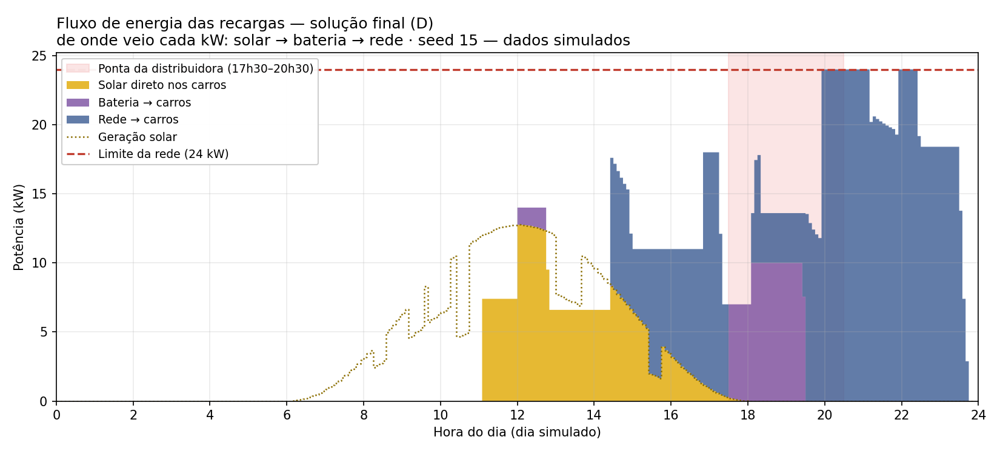

**Bateria: autoconsumo (C) x preditiva (D).** As duas enchem com o sol da manhã. C gasta a carga entre 14h30 e 16h30,
com o kWh barato; D segura a carga até a ponta.

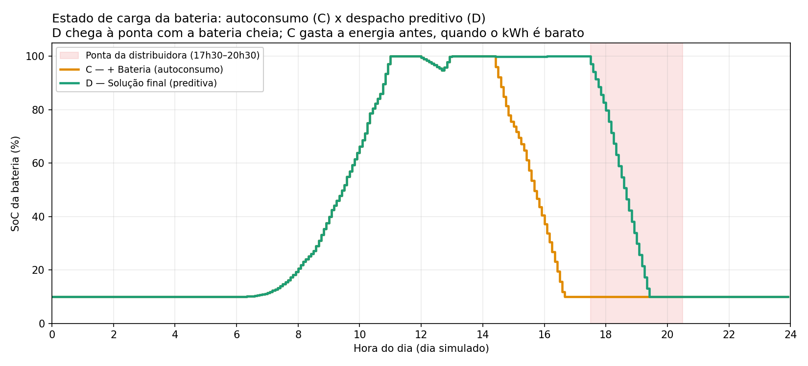

**Rede nas 4 estratégias.** Sem gestão (cinza), a rede passa de 30 kW às 20h. Com controle, nunca passa de 24 kW. Na
ponta, a curva verde (D) fica abaixo de todas.

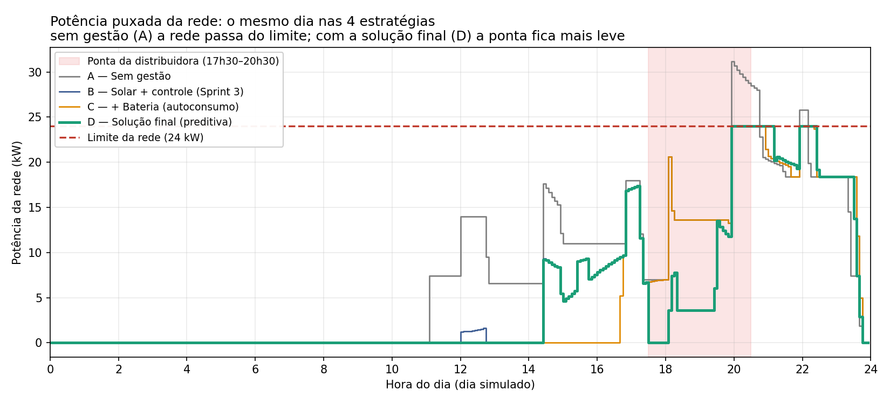

**Comparativo.**

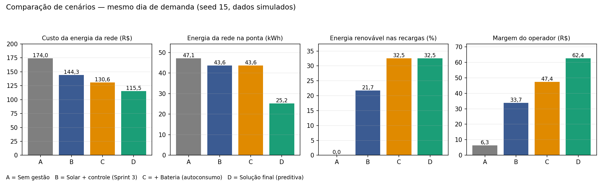

**Agendamento inteligente.** A área vermelha é a potência reduzida ou adiada: entre 20h e 21h15 a demanda pede até
31,6 kW e o agendador entrega 24 kW, priorizando quem sai mais cedo. Todas as 9 promessas foram cumpridas.

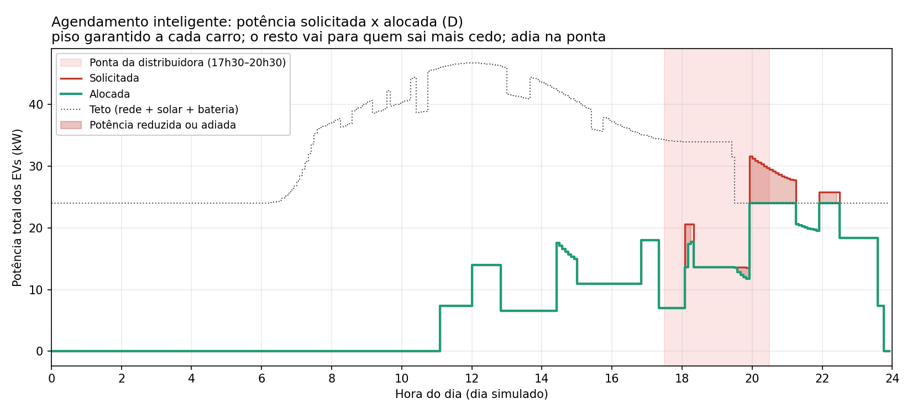

Os gráficos 02 (origem da energia por hora) e 04 (previsão x dia real) estão em
[`docs/resultados/`](docs/resultados/).

### 8.3 Robustez: 30 dias simulados, 4 estratégias cada

A seed de demonstração foi escolhida por uma regra explícita (seção 12). Para mostrar que o resultado **não depende
dela**, `python -m chargegrid.varredura --n 30` roda 30 dias diferentes
([tabela completa](docs/resultados/varredura_cenarios.md)):

| Indicador (média de 30 dias) | A | B | C | D | D melhor / pior que B | D melhor / pior que C |
|---|---:|---:|---:|---:|---:|---:|
| Custo da energia da rede (R$/dia) | 128,93 | 108,45 | 88,39 | **82,84** | 30 / 0 | 24 / 5 |
| Energia da rede na ponta (kWh/dia) | 33,3 | 30,9 | 24,3 | **16,1** | 30 / 0 | 26 / 0 |
| Energia renovável nas recargas (%) | 0,0 | 18,5 | **33,9** | 33,0 | 30 / 0 | 0 / 22 |
| Minutos acima do limite da rede | 74 | 0 | 0 | 0 | — | — |
| Promessas de carga cumpridas (%) | 100,0 | 85,3 | 88,7 | **89,7** | 4 / 4 | 3 / 5 |
| Energia pendente na saída (kWh/dia) | 0,00 | 1,31 | 0,83 | **0,48** | 11 / 3 | 10 / 3 |
| Margem do operador (R$/dia) | 6,44 | 24,10 | 44,89 | **50,67** | 30 / 0 | 25 / 4 |

- **Custo:** D é a mais barata em média e vence a Sprint 3 em **30 de 30 dias**.
- **Rede:** **0 violação** do limite em 30 dias com qualquer estratégia com controle; sem gestão foram 2.215 min.
- **Trocas honestas de D em relação a C:**
  - D fica cerca de 1 ponto percentual abaixo em renovável e compra um pouco mais de energia no total, porque segura
    a bateria para a ponta e, em alguns dias, sobra sol quando ela já está cheia;
  - em 5 dos 30 dias, C sai mais barata: a previsão é uma média, e um dia real pode não seguir o padrão;
  - é a mesma troca, entre % renovável e custo, que o Challenge mediu no modo "reserva para a ponta".
- **Promessas:** A cumpre 100% porque não tem limite, ao preço de passar dos 24 kW. Entre as estratégias que
  respeitam a rede, D cumpre mais promessas e deixa **63% menos energia pendente** que a Sprint 3. As promessas
  perdidas são pequenas: em média 0,48 kWh por dia, somando todos os carros.

### 8.4 Resultados qualitativos: o sistema funcionando

**Painel interativo** (`streamlit run painel.py`). Indicadores da estratégia escolhida, comparados com A, e o fluxo de
energia. Na barra lateral é possível mudar o dia, a usina, a bateria e a carga da rede e ver o efeito na hora.

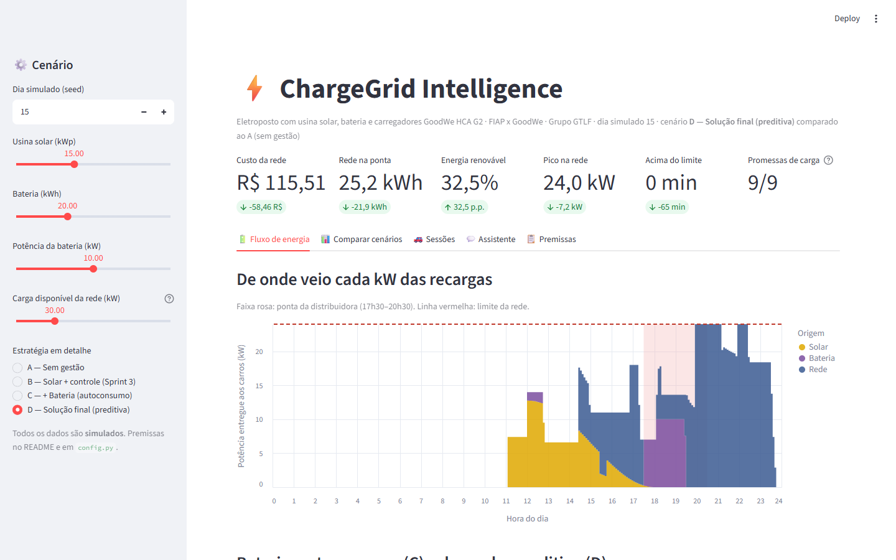

**Comparar cenários** no painel: rede nas quatro estratégias e os indicadores lado a lado.

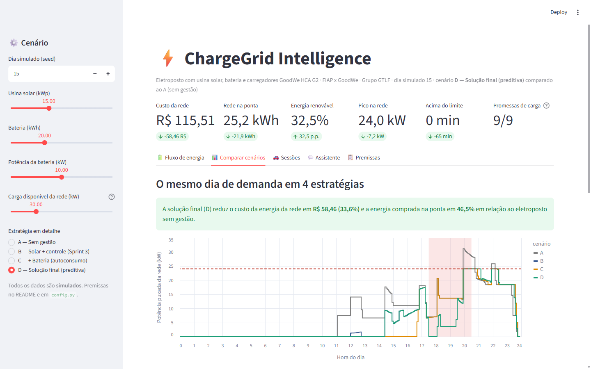

**Assistente virtual** respondendo com os números do dia (também disponível no terminal com `--assistente` e
`--pergunta`). Relatos de fogo, fumaça, faísca ou choque recebem uma **resposta fixa de segurança**, antes de qualquer
outra regra.

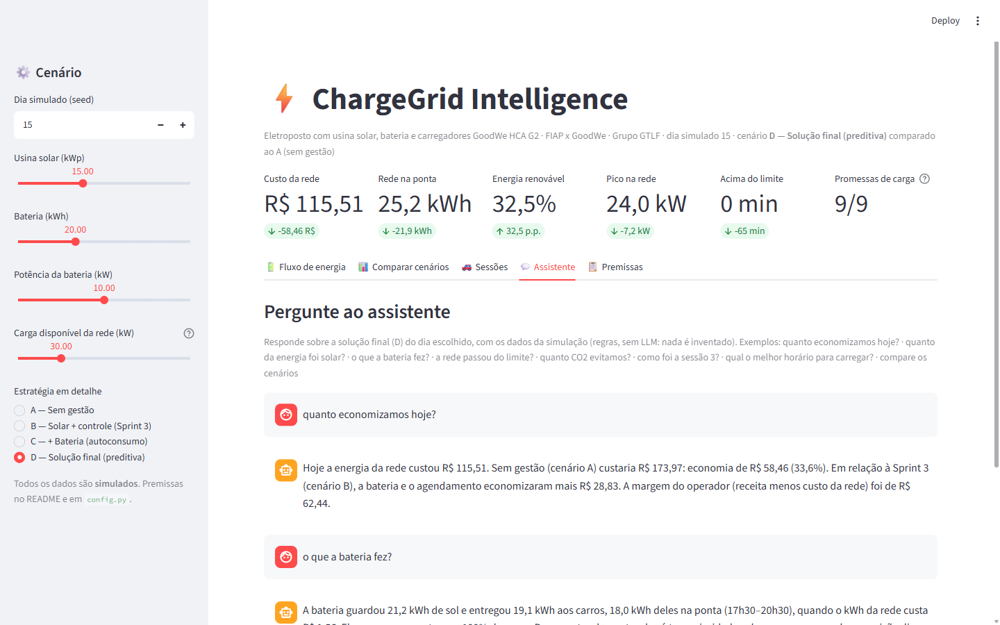

**Modo ao vivo** (`python main.py --ao-vivo --janela 17:20-18:20`). Às 17h30 começa a ponta: a rede vai a zero e a
bateria assume (`bat +6,8 kW`). Às 18h05 chegam dois carros e o agendador adia o carro do P4, que tem folga até a saída:

```text
17:25  sol   0,3 | EVs   7,0 | rede   6,7/24 [████░░░░░░░░░░░░] | bat   0,0 kW 100% | interm
17:30  sol   0,2 | EVs   7,0 | rede   0,0/24 [░░░░░░░░░░░░░░░░] | bat + 6,8 kW  97% | PONTA
17:35  sol   0,2 | EVs   7,0 | rede   0,0/24 [░░░░░░░░░░░░░░░░] | bat + 6,8 kW  94% | PONTA
18:05  sol   0,0 | EVs  13,6 | rede   3,6/24 [██░░░░░░░░░░░░░░] | bat +10,0 kW  76% | PONTA  | REDUZ 66%
         > StartTransaction P1 (BYD Dolphin, SoC 24%, sai 21:15)
         > StartTransaction P2 (Renault Kwid E-Tech, SoC 38%, sai 22:20)
         > SetChargingProfile P4 -> 0.0 kW
18:10  sol   0,0 | EVs  17,4 | rede   7,4/24 [█████░░░░░░░░░░░] | bat +10,0 kW  71% | PONTA  | REDUZ 85%
         > SetChargingProfile P4 -> 3.8 kW
```

**Comandos automatizados.** O dia gerou **433 mensagens OCPP 1.6J**: 339 `MeterValues`, 76 `SetChargingProfile`, 9
`StartTransaction` e 9 `StopTransaction` ([exemplos](docs/resultados/ocpp_exemplo.jsonl)).

**Dashboard de terminal** completo em [`docs/resultados/dashboard.txt`](docs/resultados/dashboard.txt).

**Qualidade verificada:** 230 testes automatizados, incluindo os invariantes físicos em todo intervalo de 15 dias × 4
estratégias:

- a energia fecha: solar + bateria + rede = entregue;
- a geração fecha: sol nos carros + sol na bateria + excedente = geração;
- a rede nunca passa do limite quando há controle;
- a bateria nunca carrega e descarrega ao mesmo tempo, e o balanço do dia fecha com as perdas;
- o SoC fica sempre entre 10% e 100%.

---

## 9. Avaliação crítica: sustentabilidade, inovação e limites

### 9.1 Benefícios de sustentabilidade

- **Renovável de verdade:** de 0% para 32,5% da energia das recargas vindo do sol, direto ou pela bateria, no dia de
  demonstração; 33% em média nos 30 dias.
- **Alívio da rede na ponta, o ganho mais relevante no Brasil:** −46,5% de energia comprada entre 17h30 e 20h30, e
  nenhum minuto acima do limite. É o horário em que a rede está mais carregada e em que a recarga de veículos
  elétricos tende a crescer.
- **CO₂: avaliado sem exagero.**
  - Comparado a carros a combustão, os 175,9 kWh do dia evitam **131,9 kg de CO₂** (método do Challenge).
  - O ganho **adicional** da solução sobre a rede é pequeno: 2,64 kg/dia de A para D. Isso acontece porque a matriz do
    SIN já é muito limpa (0,0461 kg CO₂/kWh).
  - No Brasil, o argumento ambiental do solar no eletroposto é menor que o argumento econômico e o de alívio da rede.
    Dizemos isso porque é o que os números mostram.
- **Sustentabilidade econômica:** sem gestão, a margem do operador é de R$ 6,29/dia, praticamente nula. Com a
  solução, R$ 62,44. Um eletroposto que não se paga não ajuda a eletromobilidade.

**Ganhos de eficiência e automação (dia de demonstração):**

| Ganho | Valor |
|---|---|
| Energia comprada da rede por kWh entregue | 1,00 (A) → **0,67** (D) |
| Custo da rede por kWh entregue | R$ 0,99 (A) → **R$ 0,66** (D) |
| Decisões automáticas por dia | 288 intervalos × (4 pontos + bateria), sem intervenção humana |
| Comandos enviados aos carregadores | 76 `SetChargingProfile`, só quando o limite muda (sem tráfego desnecessário) |
| Capacidade sem obra | a demanda pede até 31,6 kW e a rede nunca passa de 24 kW; ainda assim, as 9 promessas de carga são cumpridas, porque o agendador reorganiza a recarga no tempo em vez de exigir uma conexão maior |

**Relevância social:**

- **Motorista atendido:** quem informa a hora de saída recebe a carga prometida (9 de 9 no dia; 89,7% em 30 dias,
  contra 85,3% da Sprint 3), em vez de um corte igual para todos que pode deixar alguém sem carga.
- **Recarga mais barata para o motorista:** a mesma energia sai por R$ 177,94 em vez de R$ 180,26, porque parte dela
  sai do horário de pico.
- **Eletroposto viável onde as pessoas estão:** um shopping consegue oferecer recarga com a conexão que já tem, e com
  margem positiva, sem obra de reforço da rede. Isso amplia o acesso à recarga.
- **Benefício para quem nem tem carro elétrico:** tirar consumo da ponta reduz a pressão sobre a rede da
  distribuidora no horário mais crítico, que é compartilhada por todos os consumidores.

### 9.2 Inovação

1. **A previsão comanda o hardware.** Na Sprint 3 a previsão só gerava texto. Agora ela decide, a cada 5 minutos, quanto
   sol guardar e quanto liberar. O ganho de C para D (−R$ 15,13 com a mesma bateria) mede o valor dessa inteligência
   isoladamente.
2. **Agendamento pelo horário de saída.** O motorista diz quando vai embora e o sistema garante a carga prometida,
   adiando só quem tem folga. Isso substitui o corte "todos perdem igual" por um corte justo.
3. **Prova por ablação.** Quatro estratégias, o mesmo dia e 30 dias de varredura: cada peça tem seu ganho medido, em
   vez de um único número "com e sem sistema".
4. **Interface e assistente.** Um painel que responde "e se a bateria fosse de 40 kWh?" em segundos e um assistente
   que responde em português sem inventar números.
5. **Integração por contrato.** Os dados saem no formato da API da plataforma do grupo, prontos para a tela que já
   existe.

### 9.3 Limitações (transparência)

- **Tudo é simulado.** Não há comunicação real OCPP/MODBUS/SEMS+; as mensagens são estruturas equivalentes. O
  SEMS+ real é *pull-only*: comandar o HCA G2 ou a bateria de verdade exigiria gestão de carga local ou OCPP. O
  Challenge documenta a mesma limitação.
- **Bateria e usina são premissas**, não a ficha técnica de um modelo GoodWe específico.
- **A previsão é estatística** (média histórica por hora), não aprendizado de máquina; o Challenge usa Prophet.
- **Demanda não reage ao preço:** não há dado de elasticidade. A permanência no shopping (1h30 a 4h30) também é
  premissa.
- **Excedente solar sem crédito:** a energia injetada na rede não é valorizada pelo sistema de compensação (SCEE).
  As tarifas não incluem impostos nem bandeira.
- **Um dia por execução:** a bateria começa cada dia no mínimo, sem energia "de graça" do dia anterior, e todos os
  carros saem até a meia-noite.
- **O assistente é por regras**, não um LLM. Isso é deliberado: responde em milissegundos, funciona offline e nunca
  inventa números. Em troca, só entende as perguntas previstas.

---

## 10. Referências e conexões com frameworks, ferramentas, linguagens e sensores

**Linguagem e bibliotecas**

| Ferramenta | Uso |
|---|---|
| Python 3.10+ | Linguagem de todo o projeto |
| pandas | Telemetria, métricas, previsão e varredura |
| matplotlib | Os 7 gráficos PNG |
| Streamlit + Altair | Painel web interativo e gráficos do painel |
| pytest (+ `streamlit.testing`) | 230 testes, incluindo a interface |
| ruff | Lint e formatação |
| GitHub Actions | CI em Python 3.10, 3.12 e 3.14 |

**Protocolos e "sensores" (simulados)**

| Protocolo ou dispositivo | Representação |
|---|---|
| OCPP 1.6J (Open Charge Alliance) | `StartTransaction`, `MeterValues`, `SetChargingProfile` e `StopTransaction` em JSON (`ocpp.py`) |
| MODBUS (medidor de energia por ponto) | Registradores de potência ativa (W) e energia acumulada (Wh) (`medidor.py`) |
| Inversor híbrido e BMS da bateria | Geração FV, SoC e setpoint de carga/descarga (`solar.py`, `bateria.py`) |
| GoodWe SEMS+ | Contrato de leitura do Challenge (`exportar.py`) |

**Fontes de dados oficiais** (conforme consultadas e registradas no Challenge, `docs/sers-sprint4.md`, seção 6.5)

- ANEEL. *Resolução Homologatória nº 3.596/2026*, Enel Distribuição São Paulo, Tabela 2: Tarifa Branca B3, com ponta
  a R$ 1.559,11/MWh, intermediário a R$ 1.031,79/MWh e fora de ponta a R$ 685,01/MWh (sem impostos e sem bandeira).
- Enel São Paulo. *Tarifa Branca*: postos tarifários (ponta das 17h30 às 20h30; intermediário das 16h30 às 17h30 e
  das 20h30 às 21h30).
- MCTI/SIRENE. *Fator médio de emissão do SIN, inventários corporativos*: 0,0461 tCO₂/MWh (média de 2025).

**Equipamentos GoodWe**

- GoodWe. *HCA G2: AC EV charger.* <https://en.goodwe.com/hca-g2>
- GoodWe SEMS+: plataforma de monitoramento (modelo *pull*).

**Projeto do grupo**

- ChargeGrid-Manager (Challenge): <https://github.com/rafaperes21/ChargeGrid-Manager>
- Sprint 3 de Python (base desta entrega): <https://github.com/thorflk/SPRINT03-PYTHON-GTLF>

---

## 11. Como executar

Pré-requisito: Python 3.10 ou superior.

```bash
python -m venv .venv
.venv\Scripts\activate             # Windows (PowerShell/CMD)
# source .venv/bin/activate        # Linux/macOS
pip install -r requirements.txt

python main.py                     # 4 cenários + dashboard + arquivos na pasta saida/
streamlit run painel.py            # painel interativo no navegador
python main.py --ao-vivo           # a ponta, intervalo a intervalo (cenário D)
python main.py --assistente        # conversa com o assistente no terminal
python main.py --pergunta "quanto economizamos hoje?"
```

Testes e verificações:

```bash
pip install -r requirements-dev.txt
pytest                             # 230 testes
ruff check .                       # lint
python -m chargegrid.varredura --n 30    # varredura de 30 dias x 4 estratégias
```

| Opção de `main.py` | Padrão | Descrição |
|---|---|---|
| `--seed` | 15 | Dia simulado (mesma seed, mesmo resultado) |
| `--dias-historico` | 14 | Dias usados para ajustar a previsão |
| `--saida` | `saida` | Pasta dos arquivos gerados |
| `--ao-vivo` | desligado | Imprime o dia intervalo a intervalo |
| `--estrategia` | `D` | Cenário mostrado no modo ao vivo (`A`, `B`, `C` ou `D`) |
| `--janela` | `17:00-21:00` | Faixa de horário do modo ao vivo |
| `--velocidade` | 0,05 | Segundos entre intervalos no modo ao vivo |
| `--sem-graficos` / `--sem-dashboard` | desligado | Não gera os PNG / não imprime o dashboard |
| `--pergunta "..."` | — | Pergunta ao assistente (pode repetir) |
| `--assistente` | desligado | Conversa interativa com o assistente (`sair` encerra) |

Arquivos gerados em `saida/`: `telemetria.csv`, `sessoes.csv`, `cenarios.csv`, `resumo.json`, `ocpp_log.jsonl`,
`chargegrid_manager_energy_flow.json` e os 7 gráficos.

---

## 12. Premissas

Todas estão em [`chargegrid/config.py`](chargegrid/config.py), com a origem de cada valor.

| Parâmetro | Valor | Origem |
|---|---|---|
| Pontos de recarga | P1 7,4 · P2 11 · P3 22 · P4 7,4 kW | Sprint 2 |
| Carga disponível / limite operacional | 30 kW × 0,80 = 24 kW | Premissa do grupo / margem do Challenge |
| Usina solar | 15 kWp, perdas de 15%, nuvens aleatórias | **Premissa do grupo** |
| Bateria | 20 kWh, 10 kW, 90% de eficiência, SoC de 10% a 100%, começa o dia no mínimo | Valores do Challenge; **premissa de simulação** |
| Preço ao motorista | R$ 0,85/kWh; R$ 1,40/kWh das 18h às 21h | Sprint 2 |
| Custo da rede para o operador | Tarifa Branca B3, Enel SP | ANEEL (seção 10) |
| Fator de emissão da rede | 0,0461 kg CO₂/kWh | MCTI (seção 10) |
| Permanência no shopping | 1h30 a 4h30 | **Premissa do grupo** |
| Promessa de carga | SoC alcançável com 85% da potência máxima no tempo de permanência | **Premissa do grupo** |
| Margem do agendador | Supõe 60% da potência no futuro ao decidir adiar | **Premissa do grupo** |
| Previsão solar do despacho | 80% da geração de céu limpo | **Premissa do grupo** (as nuvens simuladas tiram ~8%) |
| Seed de demonstração | 15 | Menor seed de 1 a 60 em que: (1) sem gestão a rede passa ≥ 30 min do limite e passa dos 30 kW; (2) a Sprint 3 reduz potência ≥ 30 min; (3) o custo cai a cada etapa, A > B > C > D; (4) D cumpre ao menos tantas promessas quanto B e C; (5) há ≥ 8 sessões; (6) a bateria chega à ponta com ≥ 90%. A seção 8.3 mostra que os ganhos valem nos outros dias |

---

## 13. Estrutura do repositório

```text
.
├── main.py                    # CLI: 4 cenários, dashboard, arquivos, modo ao vivo, assistente
├── painel.py                  # painel web interativo (Streamlit)
├── chargegrid/
│   ├── config.py              # premissas e fontes (fonte única de verdade)
│   ├── estrategias.py         # cenários A-D e parâmetros da instalação
│   ├── simulacao.py           # laço de 5 em 5 min que integra tudo
│   ├── solar.py               # geração fotovoltaica
│   ├── bateria.py             # bateria: limites, SoC e perdas
│   ├── despacho.py            # solar → bateria → rede + despacho preditivo
│   ├── demanda.py             # controle proporcional + agendamento por folga
│   ├── sessoes.py             # sessões, promessa de carga, folga e piso
│   ├── veiculos.py            # catálogo de veículos
│   ├── tarifacao.py           # preço ao motorista + Tarifa Branca (Decimal)
│   ├── previsao.py            # previsão por hora, backtest e recomendações
│   ├── medidor.py             # registradores estilo MODBUS
│   ├── ocpp.py                # mensagens OCPP 1.6J
│   ├── exportar.py            # contrato EnergyFlowResponse do Challenge
│   ├── assistente.py          # assistente virtual por regras
│   ├── relatorio.py           # métricas, resumo, dashboard
│   ├── graficos.py            # 7 gráficos PNG
│   ├── varredura.py           # 30 dias x 4 estratégias
│   └── formato.py             # formatação pt-BR
├── tests/                     # 230 testes pytest
├── docs/
│   ├── diagramas.md           # 6 diagramas Mermaid
│   ├── resultados/            # resultados da seed de demonstração e varredura
│   └── img/                   # capturas do painel
├── .github/workflows/ci.yml   # lint, testes e execução em cada push
├── requirements.txt / requirements-dev.txt
└── LICENSE                    # MIT
```

---

*ChargeGrid Intelligence · FIAP x GoodWe · Pensamento Computacional e Automação com Python · Grupo GTLF*
