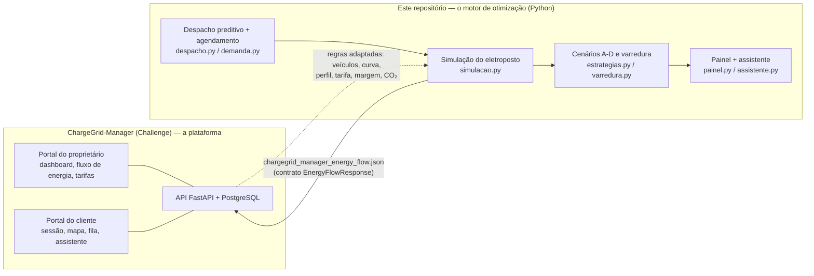
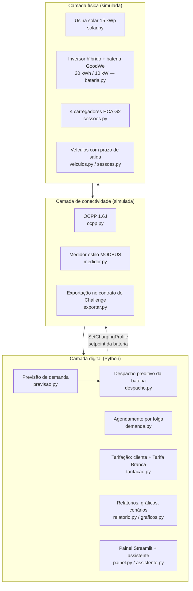
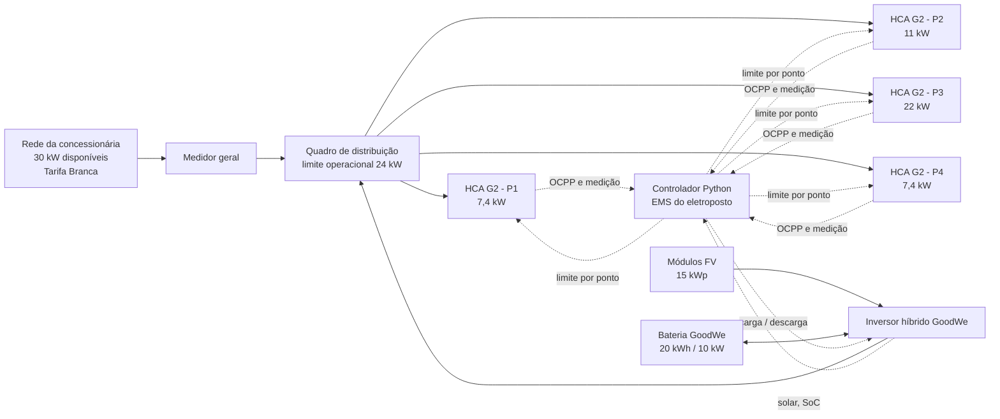
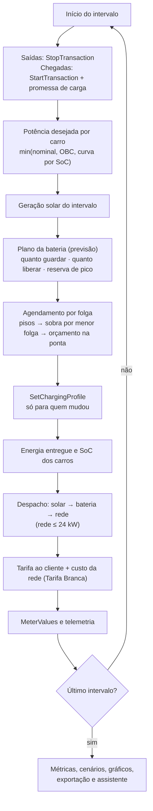
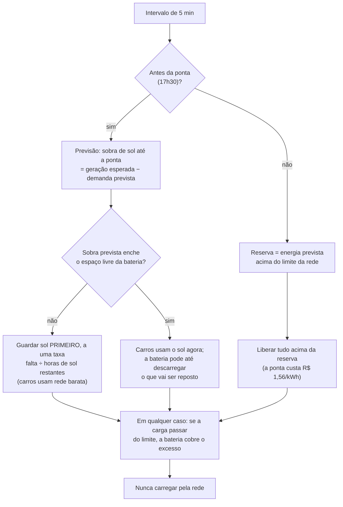
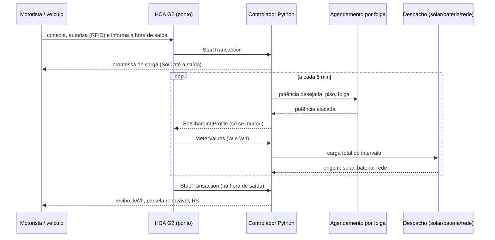

# Diagramas de arquitetura e integração — Sprint 4

Diagramas em [Mermaid](https://mermaid.js.org/), renderizados automaticamente pelo GitHub. Todos descrevem o
código **deste repositório** (os nomes de arquivo apontam onde cada bloco está implementado).

## 1. Onde este repositório se encaixa no ChargeGrid

## 2. Blocos: as três camadas da Sprint 1 na solução final

## 3. Esquema elétrico unifilar simplificado

O limite de 24 kW (30 kW × 0,80) vale para a **importação da rede**. Solar e bateria entram atrás do inversor
híbrido, no mesmo barramento; por isso o teto de potência para os carros é `limite + solar + descarga possível da
bateria`.

## 4. Um intervalo de 5 minutos (laço de `simulacao.py`)

## 5. Decisão do despacho preditivo da bateria (`despacho.plano_da_bateria`)

## 6. Sequência de uma sessão de recarga

